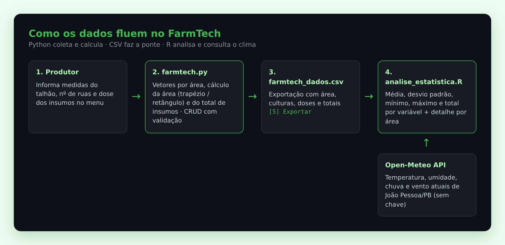
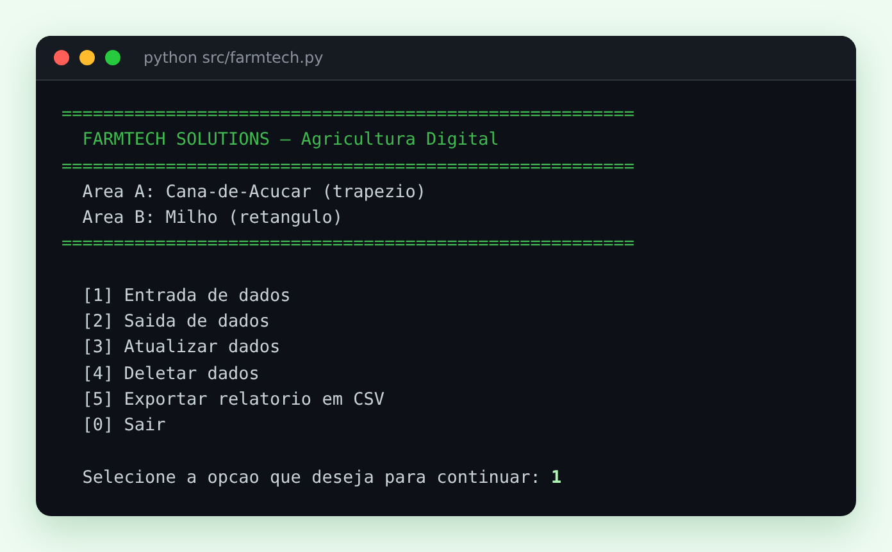
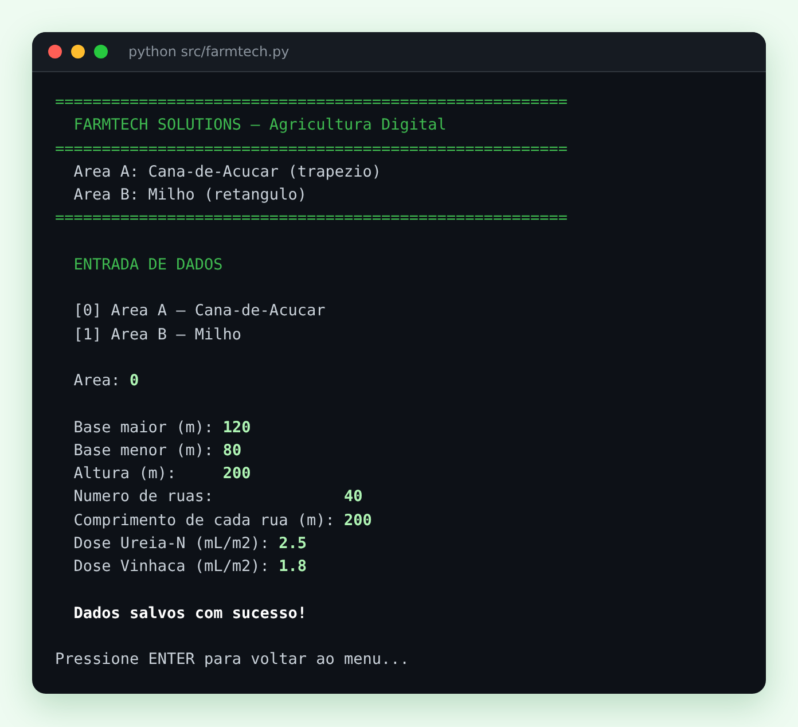
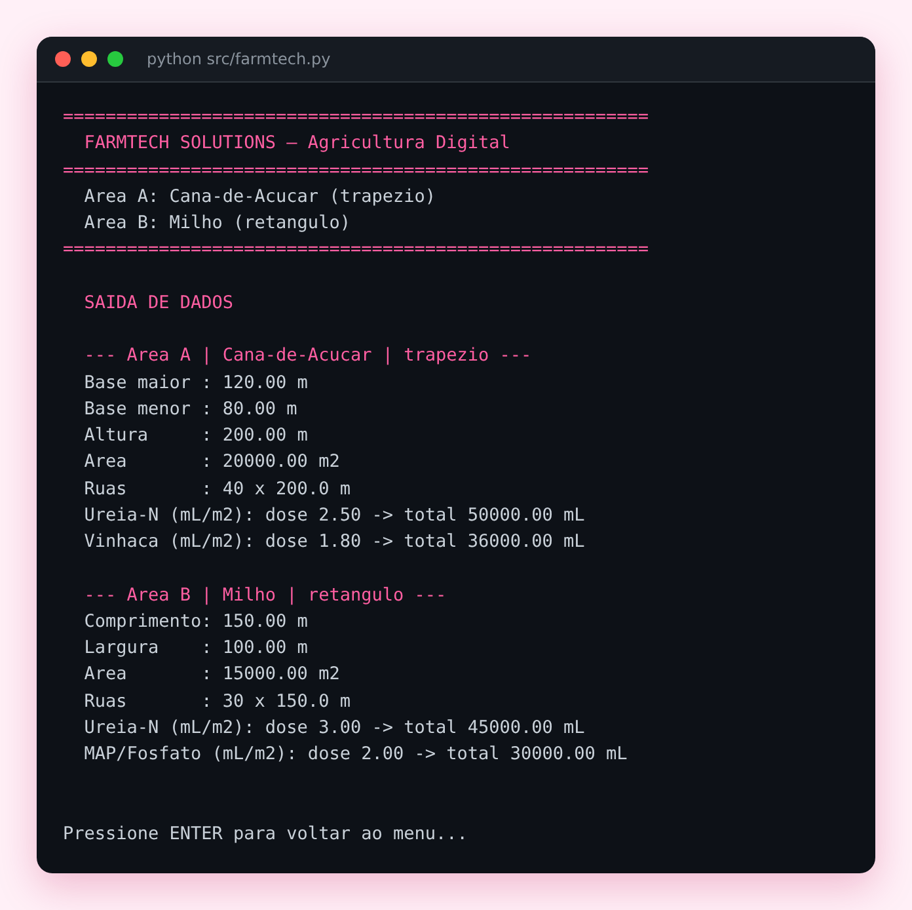
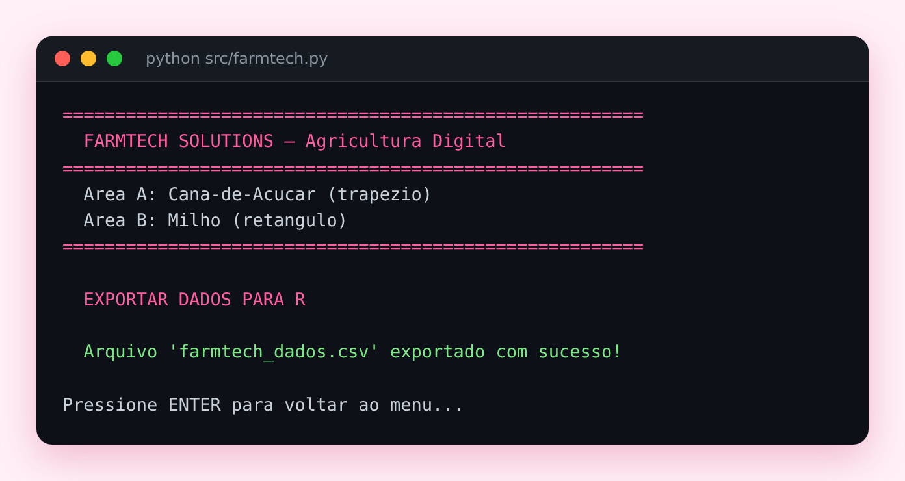
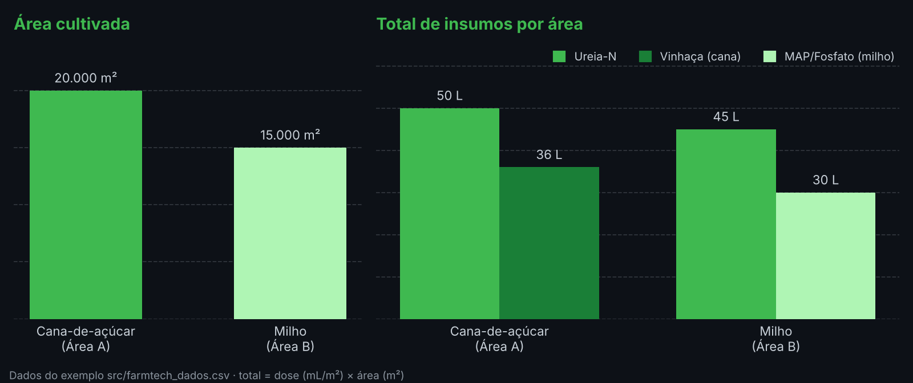

# FIAP - Faculdade de Informática e Administração Paulista

<p align="center">
<a href= "https://www.fiap.com.br/"></a>
</p>

<br>

# FarmTech Solutions — Sistema de Apoio à Agricultura Digital

> Calcula a área de plantio e a quantidade de insumos de cada talhão, gera um relatório estatístico em R e cruza com o clima do dia, para que o produtor saiba **quanto comprar e aplicar** antes de ir para o campo.

<p align="left">


</p>

## Projeto individual — Fase 1, Cap. 1 "Play no seu Desenvolvimento como Dev"

### 🌱 Onde este projeto começa

Esta é a **Fase 1**, o ponto de partida da FarmTech Solutions, a startup fictícia que acompanha todas as fases da graduação em IA da FIAP. Foi a primeira entrega do curso, feita **individualmente**, com o recorte no agronegócio da **Paraíba**: escolhi duas das culturas mais importantes do estado (cana-de-açúcar e milho) e usei o clima de João Pessoa como referência.

O objetivo desta fase era montar a base: coletar dados do talhão, calcular área e insumos e analisar os números. Nas fases seguintes, o projeto FarmTech evoluiu para sensores IoT, banco de dados, machine learning e cloud, já em trabalho em grupo.

### ✨ Destaques

- **Do dado de campo ao relatório:** o mesmo dado passa por duas linguagens. O Python coleta e calcula, exporta um CSV, e o R faz a análise estatística.
- **Geometria aplicada ao talhão:** a cana usa área em **trapézio** e o milho em **retângulo**, como acontece em terrenos reais e irregulares.
- **CRUD completo em vetores:** entrada, consulta, atualização em qualquer posição e deleção com confirmação, com validação de entrada (`try/except`) para não quebrar com valor inválido.
- **Dados externos em tempo real:** o R consulta a API pública **Open-Meteo** e mostra o clima atual de João Pessoa/PB junto com a análise.

## 👩‍🎓 Integrante:
- <a href="https://br.linkedin.com/in/tamiresvferreiras">Tamires Vitória Ferreira dos Santos</a>

## 📜 Descrição

A **FarmTech Solutions** é uma startup fictícia de Agricultura Digital usada como cenário ao longo da graduação em Inteligência Artificial da FIAP. Nesta primeira fase, a FarmTech fechou contrato com uma fazenda que quer migrar para a agricultura de precisão, e o desafio foi criar uma aplicação que calcula a área de plantio e o manejo de insumos de duas culturas, com análise estatística dos resultados.

As culturas escolhidas são duas das principais da **Paraíba**:

| Área | Cultura | Figura geométrica | Insumo 1 | Insumo 2 |
|---|---|---|---|---|
| A | Cana-de-açúcar | Trapézio — `((base maior + base menor) / 2) × altura` | Ureia-N (mL/m²) | Vinhaça (mL/m²) |
| B | Milho | Retângulo — `comprimento × largura` | Ureia-N (mL/m²) | MAP/Fosfato (mL/m²) |


### 🎯 O problema e para quem é

Na agricultura de precisão, aplicar insumo "no olho" significa desperdício (dinheiro e impacto ambiental) ou falta (perda de produtividade). O FarmTech resolve a primeira etapa desse processo para o **gestor da fazenda**: a partir das medidas do talhão e da dose recomendada por m², ele sabe **exatamente quanto de cada insumo precisa** em cada área, e compara as áreas com estatísticas simples antes de planejar a compra e a aplicação. A consulta ao clima ajuda a decidir **se é um bom dia para aplicar** (chuva e vento interferem na aplicação).

### 🔄 Como os dados fluem

<p align="center"></p>

### 🖥️ Demonstração

Telas reais da aplicação em Python, com os mesmos dados do `farmtech_dados.csv` de exemplo.

<table>
<tr>
<td width="50%"><br><sub><b>Menu principal</b>: as 5 operações e a saída</sub></td>
<td width="50%"><br><sub><b>Entrada de dados</b>: medidas do trapézio, ruas e doses da cana</sub></td>
</tr>
<tr>
<td width="50%"><br><sub><b>Saída de dados</b>: área calculada e total de cada insumo</sub></td>
<td width="50%"><br><sub><b>Exportação</b>: gera o CSV que o R vai ler</sub></td>
</tr>
</table>

### 📊 Resultado com os dados de exemplo

<p align="center"></p>

Com 20.000 m² de cana e 15.000 m² de milho, a fazenda precisa de **95 L de Ureia-N** no total, mais **36 L de vinhaça** para a cana e **30 L de MAP** para o milho.

### 🧩 O que tem em cada parte

**Aplicação em Python (`src/farmtech.py`)**

- Todos os dados ficam organizados em **vetores** (listas paralelas indexadas por área: `0` = A, `1` = B).
- Menu com **entrada, saída, atualização em qualquer posição do vetor, deleção** e **sair**, mais a opção de **exportar CSV** para o R.
- Laços (`while`/`for`) e estruturas de decisão (`if/elif`), com validação de entrada via `try/except` para não aceitar valores inválidos.
- O total de cada insumo é calculado como `dose (mL/m²) × área cultivada (m²)`.

**Análise em R (`src/analise_estatistica.R`)**

- Lê o `farmtech_dados.csv` exportado pelo Python e calcula **média, desvio padrão, mínimo, máximo e total** da área cultivada e de cada insumo, com o detalhamento por área.
- **Ir Além:** consulta a API pública e gratuita **[Open-Meteo](https://open-meteo.com/)** (sem chave) e exibe no terminal a temperatura, umidade, precipitação e vento atuais de **João Pessoa/PB**.

**Formação Social (`document/resumo_artigo_vant.pdf`)**

- Resumo do artigo da Embrapa *"Uso de veículos aéreos não tripulados (VANT) em Agricultura de Precisão"*, sobre o uso de drones na agricultura brasileira: componentes, tipos, sensores, benefícios e desafios de implementação.

## 🧠 Competências demonstradas

| Área | O que aparece no projeto |
|---|---|
| Lógica e estruturas de dados | Vetores paralelos, laços, decisões, funções e validação de entrada |
| Integração entre linguagens | Python → CSV → R, com o caminho do arquivo resolvido pela pasta do script |
| Estatística descritiva | Média, desvio padrão, mínimo, máximo e totais em R |
| Consumo de API | Requisição HTTP e leitura de JSON (`httr` + `jsonlite`), com tratamento de falha de rede |
| Documentação | README no modelo acadêmico FIAP, passo a passo de execução e histórico de versões |

## 📁 Estrutura de pastas

Dentre os arquivos e pastas presentes na raiz do projeto, definem-se:

- <b>assets</b>: imagens do repositório: logo da FIAP, diagrama de fluxo (`fluxo.png`), gráfico de resultados (`grafico-insumos.png`) e telas da aplicação (`screenshots/`).

- <b>document</b>: documentos do projeto — o resumo do artigo sobre VANTs pedido pela disciplina de Formação Social.

- <b>src</b>: todo o código-fonte do projeto.
  - `farmtech.py` — aplicação em Python com o menu de gestão das áreas e insumos.
  - `analise_estatistica.R` — análise estatística e consulta à API meteorológica.
  - `farmtech_dados.csv` — exemplo de dados exportados pelo Python (usado pelo R).

- <b>README.md</b>: guia e explicação geral sobre o projeto (o mesmo que você está lendo agora).

## 🔧 Como executar o código

**Pré-requisitos**

- [Python 3.8+](https://www.python.org/downloads/) — usa apenas a biblioteca padrão.
- [R 4.x](https://cran.r-project.org/) (opcionalmente o RStudio) — os pacotes `httr` e `jsonlite` são instalados automaticamente na primeira execução, se ainda não existirem.
- Internet, apenas para a parte meteorológica do R.

**Passo a passo**

1. Clone o repositório:
   ```bash
   git clone https://github.com/tamiresvferreira/FarmTechSolutions---FIAP-.git
   cd FarmTechSolutions---FIAP-
   ```
2. Rode a aplicação Python:
   ```bash
   python src/farmtech.py
   ```
   No menu, use **[1] Entrada de dados** para cadastrar a Área A e a Área B, **[2]** para conferir, **[3]** e **[4]** para atualizar ou apagar, e **[5] Exportar relatório em CSV** para gerar o `src/farmtech_dados.csv`.
3. Rode a análise em R (de qualquer pasta — o script encontra o CSV ao lado dele):
   ```bash
   Rscript src/analise_estatistica.R
   ```
   No RStudio, basta abrir o arquivo e clicar em **Source**.

> O repositório já traz um `farmtech_dados.csv` de exemplo, então o passo 3 funciona mesmo sem rodar o Python antes.

**Exemplo de execução** — saída do R com o CSV de exemplo (Área A com 20.000 m² de cana; Área B com 15.000 m² de milho):

```text
AREA CULTIVADA (m2):
  Media:         17500.00 m2
  Desvio padrao: 3535.53 m2
  Minimo:        15000.00 m2
  Maximo:        20000.00 m2
  Total fazenda: 35000.00 m2

INSUMO 1 — totais por area (mL):
  Media:         47500.00 mL
  Desvio padrao: 3535.53 mL
  ...

DETALHAMENTO POR AREA:
  Area A | Cana-de-Acucar | trapezio
    Area cultivada: 20000.00 m2
    Ureia-N (mL/m2): dose 2.50 mL/m2 -> total 50000.00 mL
    Vinhaca (mL/m2): dose 1.80 mL/m2 -> total 36000.00 mL

  Area B | Milho | retangulo
    Area cultivada: 15000.00 m2
    Ureia-N (mL/m2): dose 3.00 mL/m2 -> total 45000.00 mL
    MAP/Fosfato (mL/m2): dose 2.00 mL/m2 -> total 30000.00 mL

--- DADOS METEOROLOGICOS — Joao Pessoa / PB ---
  (temperatura, umidade, precipitação e vento atuais via Open-Meteo)
```

## 🗃 Histórico de lançamentos

* 0.3.0 - 11/11/2026
    * README com o contexto da Fase 1, destaques, problema e público, diagrama do fluxo, telas reais da aplicação e gráfico de resultados.
* 0.2.0 - 11/11/2026
    * Correções a partir do feedback da avaliação: removida a chamada `source()` do próprio script na primeira linha do R, que causava recursão infinita.
    * Pacotes do R instalados só quando faltam; o CSV é localizado pela pasta do script; a consulta à API não interrompe a análise se a internet falhar.
    * O Python passa a salvar o CSV na pasta `src/`, onde o R o procura.
    * Vídeo de demonstração substituído pelo passo a passo e pelo exemplo de execução acima.
    * Repositório organizado no modelo acadêmico FIAP (`assets`, `document`, `src`).
* 0.1.0 - 24/03/2026
    * Entrega original da atividade: aplicação Python, análise em R com API meteorológica e resumo do artigo sobre VANTs.

## 📋 Licença

<p xmlns:cc="http://creativecommons.org/ns#" xmlns:dct="http://purl.org/dc/terms/"><a property="dct:title" rel="cc:attributionURL" href="https://github.com/agodoi/template">MODELO GIT FIAP</a> por <a rel="cc:attributionName" property="cc:attributionName" href="https://fiap.com.br">Fiap</a> está licenciado sobre <a href="http://creativecommons.org/licenses/by/4.0/?ref=chooser-v1" target="_blank" rel="license noopener noreferrer" style="display:inline-block;">Attribution 4.0 International</a>.</p>
